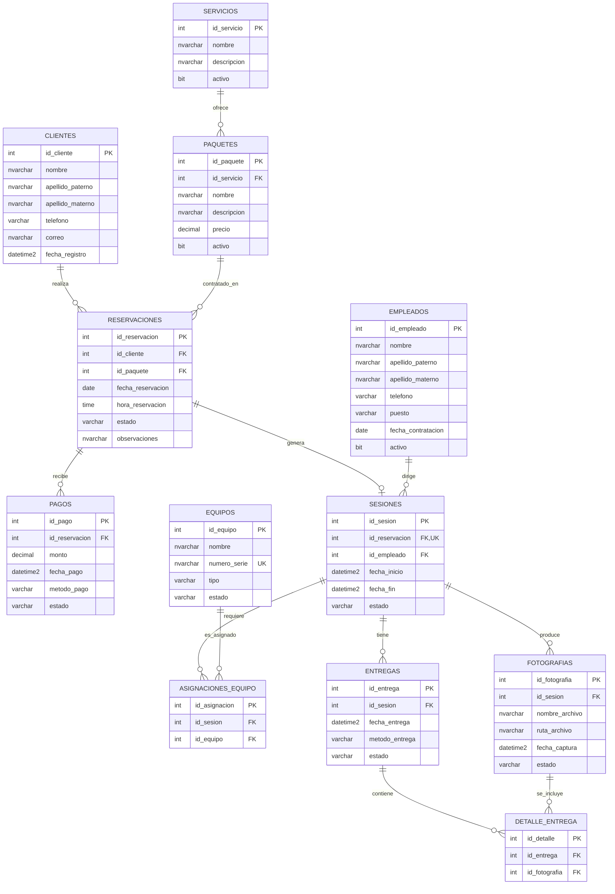

# Pixel Studio — Modelo entidad-relación (versión 1)

## Alcance y decisiones

- Una reservación corresponde a un cliente y un paquete.
- Un servicio ofrece múltiples paquetes; cada paquete pertenece a un servicio.
- Una reservación puede existir sin sesión asignada, pero se permite **como máximo una sesión** por reservación.
- Cada sesión tiene un fotógrafo principal (empleado).
- Una reservación admite varios pagos.
- Una sesión puede usar varios equipos; cada equipo puede participar en muchas sesiones **si no coinciden los horarios**.
- Una sesión genera fotografías y puede tener varias entregas parciales.
- Una entrega puede incluir varias fotografías; una fotografía puede ser incluida en distintas entregas.

## Diagrama E-R (Mermaid)

> `UK` indica clave única. La etiqueta FK,UK en `id_reservacion` significa que ese campo es a la vez clave foránea y única. En la tabla física los tipos incluyen longitudes, precisión y restricciones.

## Restricciones de negocio pendientes de implementación avanzada

1. Dos sesiones activas asignadas al mismo fotógrafo no pueden solaparse (validación transaccional).
2. Un equipo no puede estar asignado a sesiones activas con horarios superpuestos (validación transaccional).
3. Una fotografía agregada a una entrega debe pertenecer a la misma sesión que la entrega (validación entre tablas).
4. No permitir pagos que excedan el saldo contratado, si el negocio así lo define.
5. Una sesión solamente puede asignarse a empleados habilitados como fotógrafos.

Estas reglas requieren lógica entre filas o entre tablas; no quedan resueltas únicamente por las restricciones CHECK de la fase inicial.
